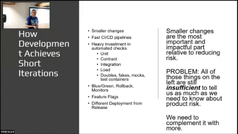
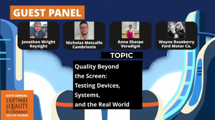
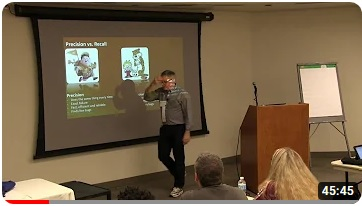
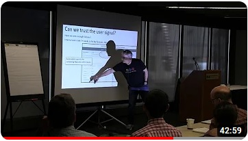
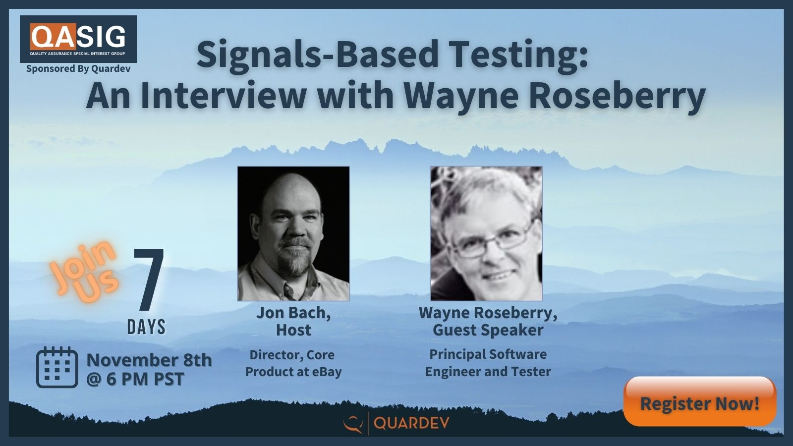

Conferences and Presentations
==========

Testing With Short Iterations
-----------------------------
This is a presentation I gave at Pacific Northwest Software Quality Conference 2026 (PNSQC 2026).

More and more development teams are shifting from sprint long release cycles with multiple weeks between new code deployment, 
to frequent deployment iterations of days or even hours. A sprint of 3 weeks that might have had only one code deployment 
at the end may now have 10, 20 or more much smaller deployments. Testing that worked to cover weeks of changes all at 
once in a single pass at the end does not fit on a short iteration model.
This session describes an effective way of organizing testing time and approach to more flexibly and responsibly cover 
short iteration cycles without compromising larger scale system and end-to-end testing that doesn't follow the 
"get rid of the tester silos" and "testers only teach developers how to test now" bandwagon.

Quality Beyond the Screen
-------------------------
This is a panel discussion at PNSQC 2026 about testing across different devices. I was pulled into this one
because they had an empty spot on the panel. The other people on this one have far more experience with testing
devices and hardware than I do, but I did have some stories and learnings to share about trying to test
Office and SharePoint across different device types before release, as well as using a telemetry signal as a way
of learning where you might have coverage gaps.

Flaky Test Automation
---------------------
This is a presentation I gave describing how the Office team at Microsoft not just manages, but
utilizes flaky test results to their advantage. I describe the important difference between using
automation to gate code submissions versus using automation to find bugs, and how flaky test
automation is an important signal in both those activities.

Using Product Signal Information In Testing
---------------------
This is a presentation where I describe how we integrated product telemetry signals
with the automation systems in Office, and different ways of using that information to
infer information about product quality as well as assess the performance and quality
of your automation suite. This talk represents a key cornerstone priniple I used for
later research applying AI to product testing practices.

November 8th, 2023, Signals Based Testing QASIG
==============================

On November 8th, 2023 at 6:00 PM Pacific Time, I spoke about signals based testing
at the Quardev Quality Assurance Special Interest Group meeting. Thank you very much
to the team there, especially Jon Bach for moderating and tossing me
questions. The recording is <a href="https://qasig.org/2023/11/09/november-2023-qasig-signals-based-testing/">available here.</a>
